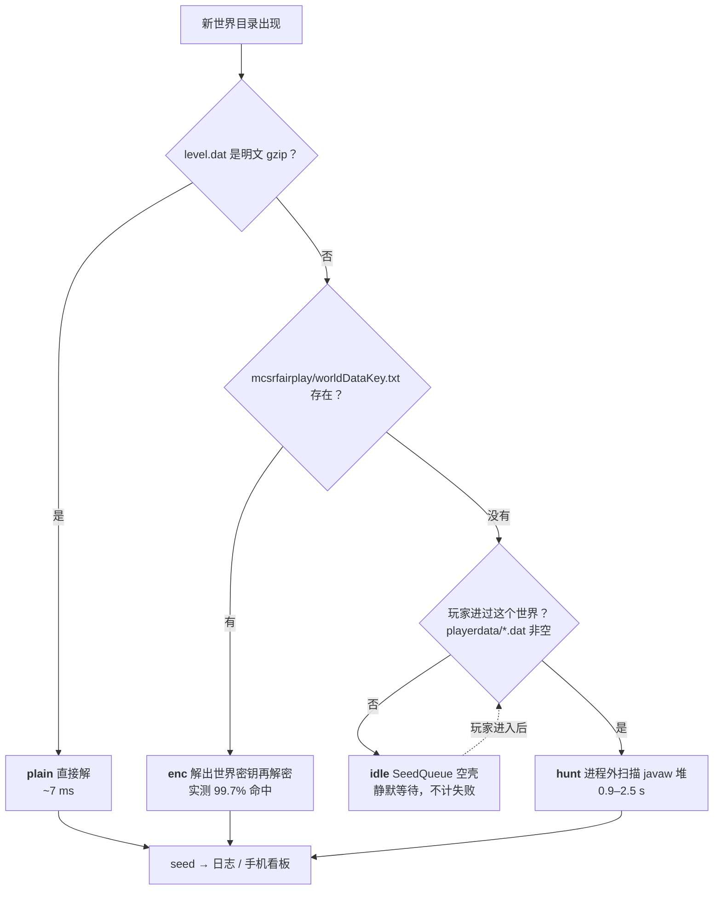
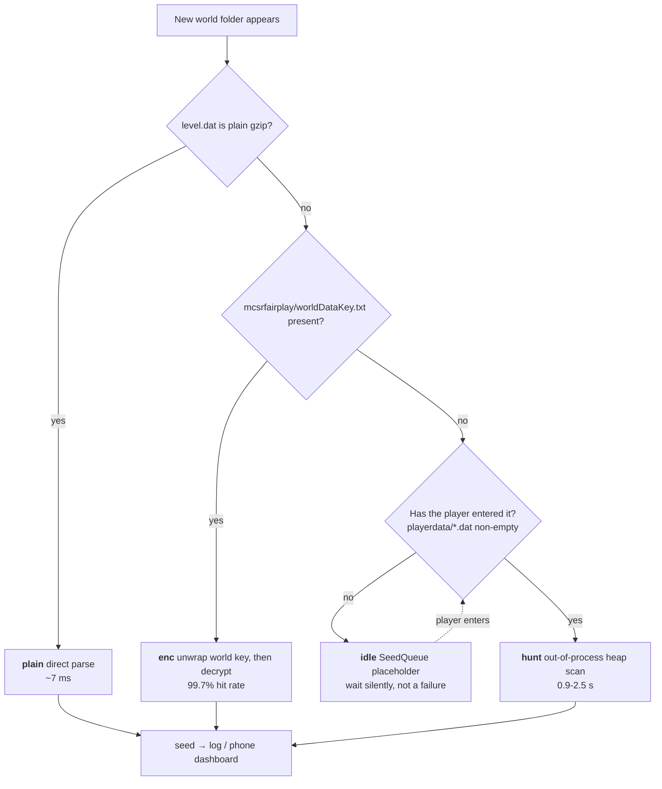

<div align="center">

# MC Seed Finder

**Minecraft 1.16.1 世界种子捕获器 —— 世界刚创建、人还在里面跑着，seed 就已经在手机上了。**

纯本地 · 零依赖 · 不注入游戏 · 游戏日志无痕

[](https://github.com/Suifeng-2077/mcseed-finder/releases/latest)


[中文](#中文) · [English](#english) · [路线图](docs/ROADMAP.md) · [后期目标设计](docs/seed-inspector-design.md)

</div>

> [!IMPORTANT]
> fairplay 只在**世界退出、落盘保存**时才写 `worldDataKey.txt`。所以正在玩的世界，磁盘上永远解不开——
> 这不是加密强度问题，是密钥根本还没写出来。本项目为此实现了 `hunt`：进程外扫 javaw 堆拿世界密钥，
> **0.9–2.5 秒**出结果，不注入、不加载 agent、不改游戏文件。

## 它解决什么

创建或重置 Minecraft 1.16.1 世界后，立刻拿到这个世界的 seed；世界正在运行时也能拿。
面向单人速通与本地研究场景，附带一个跑在手机浏览器里的看板，世界一出现就把 seed 推过去。

## 取 seed 的决策链



## 能力一览

| | 能力 | 实测 / 说明 |
|---|---|---|
| 🎯 | 四条取 seed 路径，自动择优 | `plain` / `enc` / `hunt` / `idle` |
| ⚡ | 运行中的世界也能取 | 0.9–2.5 s，进程外读取，零注入 |
| 📱 | 手机看板 | 世界出现 → 手机 **1–3 s**（明文 0.3 s） |
| 🔁 | 增量监听去重 | 按 `worldUUID` 去重，跳过 SeedQueue 空壳世界 |
| 🧾 | 失败可见 | `fail` 行写明 `key-nokey` / `key-ok` / `plain` / `absent` |
| 🔒 | 不改变游戏 | 不注入、不加组件、不改游戏文件、游戏日志无痕 |
| 🧪 | 自带测试 | 11 项：AES/inflate 对拍、NBT、CLI、看板接口 |

## 快速开始

**[⬇ 下载最新发布版](https://github.com/Suifeng-2077/mcseed-finder/releases/latest)**（`mcseed-finder-x.y.z.zip`，解压即用）

```text
1. 装 Node.js（LTS）
2. 解压发布包
3. 先启动游戏（进到能创建/重置世界的界面）
4. 双击 mcseed-app/ 里的脚本
```

| 想做什么 | 双击 |
|---|---|
| 后台监听 **+ 手机看板**（推荐） | `start-phone.bat` |
| 停止手机看板 | `stop-phone.bat` |
| 后台监听，只记日志 | `start-watch.bat` |
| 重置后按 Enter 立刻看 seed | `start-next.bat` |
| 立刻取最近世界的 seed | `start-now.bat` |

## 手机看板

```bash
node mcseed-app.js watch --poll 250 --http 8790 --http-token 你的口令
```

终端会打印可访问地址，手机连同一 WiFi / 热点，浏览器打开：

```
http://<本机局域网IP>:8790/?t=你的口令
```

- 只监听局域网、不访问外网；口令不符一律 `403`
- 新世界自动置顶，逐位「老虎机」滚动到位 + 三段震动 + 整页边缘绿色脉冲
- 点任意一条复制 seed（`http://` 下走 `execCommand` 回退，实测可用）
- PWA「添加到主屏幕」；跟随系统深/浅色主题；系统开启「减弱动效」时自动关动画
- 不想暴露端口可用 USB 隧道：`adb reverse tcp:8790 tcp:8790`，手机打开 `http://127.0.0.1:8790/?t=…`

## 命令行

```bash
node mcseed-app.js watch     # 后台监听
node mcseed-app.js next      # 等待新世界（重置 → Enter → 看 seed）
node mcseed-app.js now       # 立刻取最近的世界
node mcseed-app.js show      # 最近 10 条捕获记录
```

参数（优先级高于 `config.json`）：

| 参数 | 作用 |
|---|---|
| `--saves <目录>` | 指定存档目录（多实例切换） |
| `--poll <ms>` | 扫描间隔，默认 1200；想更快用 250 |
| `--retry <n>` / `--retry-ms <ms>` | 等 `worldDataKey.txt` 落盘的次数与间隔 |
| `--http <端口>` / `--http-token <口令>` | 开启手机看板 |
| `--http-bind <地址>` | 指定绑定的网卡地址；`127.0.0.1` 用于 USB 隧道 |
| `--no-heap` | 禁用内存扫描，只用文件 |
| `--log <文件>` / `--state <文件>` | 指定日志与去重状态 |

日志每行 6 列：`时间  类型  方式  世界名  LevelName  seed`（类型 `init/new/now/next/fail`）。

## 配置

`config.json`：

| 键 | 说明 |
|---|---|
| `savesDir` | 存档目录，留空则自动探测运行中的实例 |
| `logPath` / `statePath` | 日志与去重状态 |
| `autoHeap` | 是否允许对运行中的世界做内存扫描（默认 `true`） |
| `heapCooldownMs` | 两次扫描的最小间隔 |
| `huntThreads` | 扫描线程数（4 线程实测 0.9–2.3 s） |
| `beep` | 捕获时响一声 |

## 实测数据

| 指标 | 数值 | 来源 |
|---|---|---|
| `enc` 路径命中率 | **1405 / 1409 = 99.7%** | 本地 1409 个真实世界 |
| 单世界完整解密 + 解析 | 7 ms | AES-256 + 纯 JS inflate |
| `hunt` 全量扫描（8 线程） | 2.2–2.4 s，读 ~2 GB | 4.5 GB javaw 堆 |
| `hunt` 4 线程 | 0.9–2.3 s | 命中即停 |
| 世界出现 → 手机可见 | 1–3 s（明文 0.3 s） | 含 SSE 推送 30 ms |
| 主密钥跨版本 | 1.1.4 → 1.2.1 **未变** | 内置 1.2.1 密钥可解 1.1.4 世界 |

## 常见问题

<details>
<summary><b>为什么正在玩的世界读不到 seed？</b></summary>

fairplay 只在世界关闭、落盘保存时写 `worldDataKey.txt`。世界运行期间密钥只存在于 javaw 内存，
磁盘上只有用这把密钥加密的 `level.dat`——一把锁没有钥匙。此时走 `hunt` 从内存里取。
</details>

<details>
<summary><b>为什么对 SeedQueue 预生成的世界没反应？</b></summary>

SeedQueue 会一次预生成多个空壳世界（`playerdata` 为空）。它们没有密钥也没价值，程序判为 `idle`
静默跳过，不会刷日志、不会被判死。等你真的进入某个世界，它会被重新拾起处理。
</details>

<details>
<summary><b>会不会影响速通成绩？</b></summary>

监听本身是毫秒级的目录扫描。唯一有感知的是 `hunt` 的两秒扫描，通常落在你刚进世界、还在加载的阶段。
想更轻就降 `huntThreads`（2 线程 ≈ 2 秒，卡顿更弱）。
</details>

<details>
<summary><b>改了 fairplay 版本还能用吗？</b></summary>

主密钥在 1.1.4 → 1.2.1 之间没有变化。若将来更换，`fail` 日志会以 `key-ok` 状态明确报出
「已加密且 key 存在，但主密钥不匹配」，而不是静默失败。
</details>

## 文档与语言

| 文档 | 语言 | 说明 |
|---|---|---|
| [README.md](README.md) | **中英双语** | 入口，两份同步维护 |
| [docs/ROADMAP.md](docs/ROADMAP.md) | **中英双语** | 路线图与后期目标 |
| [docs/seed-inspector-design.md](docs/seed-inspector-design.md) | **中英双语** | Seed Inspector 技术设计 |
| [docs/使用说明.md](docs/使用说明.md) | 中文 | 面向使用者 |
| [docs/安装说明.md](docs/安装说明.md) | 中文 | 环境与安装 |
| [docs/常见问题.md](docs/常见问题.md) | 中文 | 排错 |
| [docs/原理教学.md](docs/原理教学.md) | 中文 | 三种取 seed 方式原理 |

约定：**入口与规划类文档中英双语；使用者文档目前仅中文**（英文版排期见路线图）。

## 后期目标

**Seed Inspector** —— 拿到 seed 之后，本地直接算出这把能去哪个下界猪灵堡垒 / 下界要塞、
主世界要塞 1/2 环在哪，不需要进游戏也不需要外部网站。输出为文本 / JSON / 看板卡片。

- 阶段 A（下界双堡垒）：只依赖 seed + 结构网格 + RNG，2–4 天
- 阶段 B（主世界要塞）：要塞位置依赖生物群系采样，需先实现 1.16.1 生物群系生成，2–4 周

详见 [docs/ROADMAP.md](docs/ROADMAP.md) 与 [docs/seed-inspector-design.md](docs/seed-inspector-design.md)。

## 目录结构

```
mcseed/
├── config.json
├── package.json
├── test/mcseed.test.js          # 对拍 + 端到端（npm test）
├── mcseed-app/
│   ├── mcseed-app.js            # 主程序：watch / now / next / show + 手机看板
│   ├── mcseed-lib.js            # gzip / NBT / seed 解析
│   ├── mcseed-crypto.js         # AES-128/256 CBC + fairplay 解包
│   ├── start-*.bat, stop-phone.bat
│   └── java/
│       ├── Hunt2.exe / .cs      # 内存扫描（自适应 klass、分块容错、多线程）
│       └── HuntKey.exe / .cs    # 旧版扫描器，保留兜底
└── docs/
```

## 免责声明

本项目仅供个人学习、本地研究及合法的单机 / 非排名场景使用。请在理解相关游戏规则后，自行判断使用场景与合规性。

---

<div align="center">

# English

</div>

**A seed capture tool for Minecraft 1.16.1 — know the seed while you are still playing the world.**

Local-only · zero dependencies · no injection · clean game logs

## What it does

Reveals the seed of a Minecraft 1.16.1 world right after you create or reset it — **including while the world
is still running**. Built for single-player speedrunning and local research, with a phone dashboard that
pushes each new seed to a browser on your LAN.

## The decision chain



> [!IMPORTANT]
> fairplay only writes `worldDataKey.txt` when a world is closed and saved. A running world therefore has
> an encrypted `level.dat` with no key on disk — not a crypto problem, the key simply is not there yet.
> `hunt` reads the world key out of the javaw heap from outside the process: **0.9–2.5 s**, no injection,
> no agent, no file writes.

## Features

| | Feature | Measured |
|---|---|---|
| 🎯 | Four extraction paths, auto-selected | `plain` / `enc` / `hunt` / `idle` |
| ⚡ | Works on running worlds | 0.9–2.5 s, out-of-process, zero injection |
| 📱 | Phone dashboard | world appears → phone in **1–3 s** (0.3 s plaintext) |
| 🔁 | Incremental watching with dedup | keyed by `worldUUID`, SeedQueue placeholders skipped |
| 🧾 | Visible failures | `fail` rows carry `key-nokey` / `key-ok` / `plain` / `absent` |
| 🔒 | Non-intrusive | nothing injected, no game files touched, clean logs |
| 🧪 | Tests included | 11 checks: AES/inflate cross-checks, NBT, CLI, dashboard |

## Quick start

**[⬇ Download the latest release](https://github.com/Suifeng-2077/mcseed-finder/releases/latest)** (unzip and run).

Install Node.js (LTS), extract, start the game, then double-click a script in `mcseed-app/`:

| Goal | Script |
|---|---|
| Watch + phone dashboard (recommended) | `start-phone.bat` |
| Stop the dashboard | `stop-phone.bat` |
| Watch, log only | `start-watch.bat` |
| Interactive: reset then press Enter | `start-next.bat` |
| Grab the most recent world now | `start-now.bat` |

```bash
node mcseed-app.js watch --poll 250 --http 8790 --http-token <token>
# phone (same WiFi/hotspot):  http://<lan-ip>:8790/?t=<token>
```

## Measured

| Metric | Value |
|---|---|
| `enc` hit rate | **1405 / 1409 = 99.7%** of real worlds |
| Per-world decrypt + parse | 7 ms |
| `hunt` full scan, 8 threads | 2.2–2.4 s, ~2 GB read of a 4.5 GB heap |
| `hunt`, 4 threads | 0.9–2.3 s (stops on hit) |
| World appears → phone | 1–3 s (0.3 s for plaintext), 30 ms of that is SSE |
| Master key across versions | unchanged from 1.1.4 → 1.2.1 |

## Requirements

Minecraft **1.16.1** · mcsrfairplay **1.2.1** · Node.js **≥16** · Windows (the heap scanner is a .NET binary).
JDK is only needed for `jps` process discovery.

## Documentation language policy

Entry and planning documents (`README`, `ROADMAP`, design docs) are maintained in **both Chinese and English**.
End-user guides under `docs/` are currently **Chinese-only**; English versions are on the roadmap.

## Long-term goal

**Seed Inspector** — given a captured seed, compute locally which Nether bastion/fortress and which Overworld
strongholds (rings 1–2) this run offers: terminal text, JSON, or a dashboard card. Stage A (Nether) needs only
seed + structure grid + RNG; stage B (Overworld strongholds) needs a full 1.16.1 biome generator first.
See [docs/ROADMAP.md](docs/ROADMAP.md) and [docs/seed-inspector-design.md](docs/seed-inspector-design.md).

## Tests

```bash
npm test
```

AES against NIST SP800-38A vectors plus per-block comparison with `node:crypto`; inflate against `zlib`;
NBT/seed parsing including string-form seeds; CLI end-to-end on a synthetic encrypted world; dashboard token
auth and data endpoint.

## License

[MIT](LICENSE) © Suifeng-2077

> For personal study, local research, and legitimate single-player / non-ranked use.
